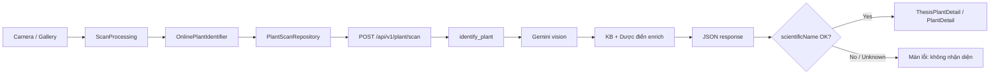
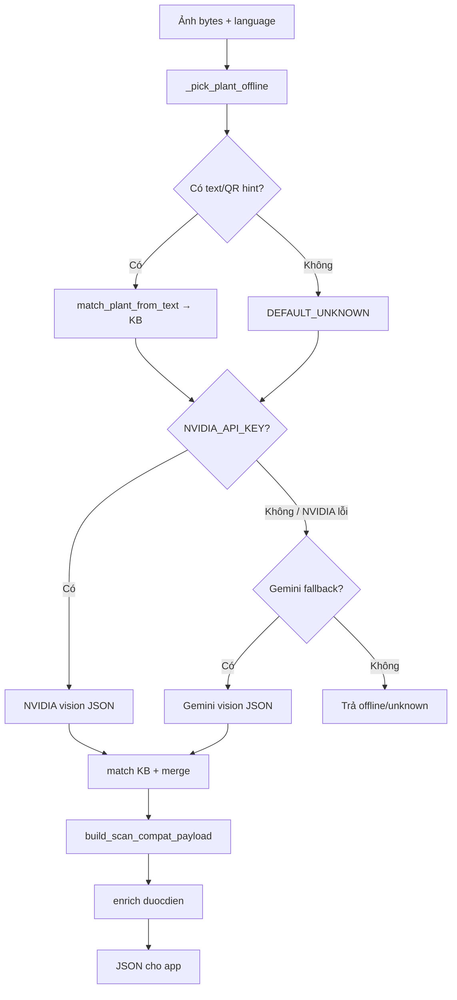
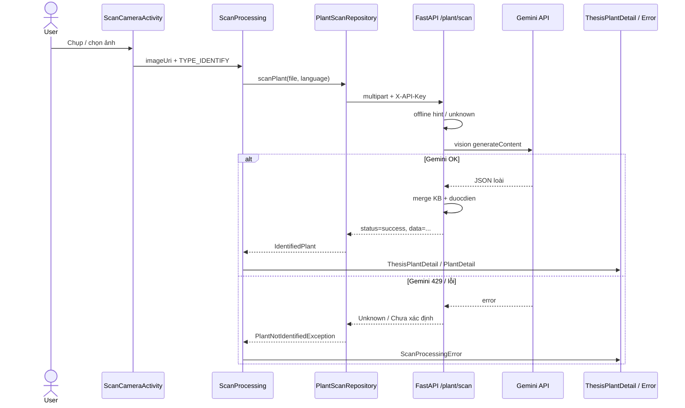

# Flow Scan nhận diện cây (hiện tại)

Tài liệu mô tả **luồng Identify** từ khi user chụp/chọn ảnh đến khi server trả kết quả và app mở màn hình chi tiết.

> Cập nhật: 2026-08-10 — phản ánh code đang chạy (debug + FastAPI local/ngrok).

---

## 1. Tổng quan



**Endpoint:** `POST {PLANT_API_BASE_URL}api/v1/plant/scan`  
**Header:** `X-API-Key: lamma.scan.plant`  
**Body:** `multipart/form-data` — `file` (ảnh) + `language` (vd: `vi`)

---

## 2. Phía App (Android)

### 2.1. Chụp / chọn ảnh

| Bước | Thành phần | Việc làm |
|------|------------|----------|
| 1 | `HomeActivity` → nút camera | Mở `ScanCameraActivity` |
| 2 | `ScanCameraActivity` | Tab **Identify** / Diagnose; chụp CameraX hoặc chọn gallery |
| 3 | Sau khi có `imageUri` | Gọi `ScanProcessingActivity.start(imageUri, cameraMode, imageSource)` |

Debug hiện tại (`app/build.gradle.kts`):

- `USE_LOCAL_PLANT_API = true` → **luôn online FastAPI**, bỏ TFLite offline.
- `PLANT_API_BASE_URL` (debug + release) → `https://identifierapp-server-hmvz.onrender.com/`

### 2.2. Màn xử lý

```
ScanProcessingActivity
  └─ ScanProcessingViewModel.startProcessing()
       └─ ScanProcessingService.process()
            └─ (Identify) PlantIdentifyRepositoryImpl.identify(mode=ONLINE)
```

`ScanProcessingService` (Identify):

1. Nếu `USE_LOCAL_PLANT_API` → ép `ModeScan.ONLINE`.
2. Gọi `identifyRepository.identify(imageUri, imageSource, ONLINE)`.

### 2.3. Gửi ảnh lên server

```
PlantIdentifyRepositoryImpl
  └─ OnlinePlantIdentifier.identify(uri)
       ├─ Kiểm tra mạng
       ├─ UploadImageFileResolver.resolveToFile(uri)
       └─ PlantScanRepository.scanPlant(file)
            ├─ PlantImageUploadHelper.validate + compress (JPEG)
            ├─ Retrofit PlantBackendApiService.scanPlant(multipart, language)
            │    Header: X-API-Key
            │    (+ ngrok-skip-browser-warning nếu host chứa "ngrok")
            └─ Parse PlantScanResult
```

**Timeout mạng (debug):** connect 60s / read-write 120s (`Constants.kt`) — để chịu cold-start Render.

### 2.4. Validate kết quả phía app

Trong `PlantScanRepository` / `OnlinePlantIdentifier`:

- `status != success` hoặc `data == null` → lỗi.
- `scientificName` rỗng / `"Unknown"` / `"null"` → `PlantNotIdentifiedException` → UI **không nhận diện được**.
- Confidence / scientificName còn qua `PlantIdentifyValidation.validateIdentifyResult`.

Nếu OK:

1. Lưu payload vào `PlantScanSession` (cho màn thesis detail).
2. Map sang `IdentifiedPlant`.
3. (Tuỳ chọn) match thêm catalog nội bộ app qua `plantRepository.resolvePlantForIdentify(...)`.
4. Identify thành công có thể tạo reminder mặc định.

### 2.5. Điều hướng UI sau scan

`ScanProcessingActivity.navigateToResultOrError`:

| Điều kiện | Màn hình |
|-----------|----------|
| Có `PlantScanSession` + `hasThesisDetail` | `ThesisPlantDetailActivity` (cây thuốc / độc / uses / care / folk…) |
| Match catalog app (`resolvedPlantId`) | `PlantDetailActivity` |
| Không nhận diện / lỗi mạng / server | `ScanProcessingErrorActivity` |

---

## 3. Phía Server (FastAPI — `/Users/tt/web/server`)

### 3.1. Route

```
POST /api/v1/plant/scan
  └─ require_api_key (X-API-Key)
  └─ đọc bytes ảnh
  └─ identify_plant(image_bytes, language, settings)
  └─ return { "status": "success", "data": <payload Android> }
```

File: `app/routers/plant.py` → `app/services/plant_service.py`.

### 3.2. `identify_plant` — logic hiện tại



Vision (NVIDIA/Gemini) **chỉ trả JSON loài**. Phần còn lại giữ nguyên: merge KB, Dược điển, payload Android qua `PLANT_API_BASE_URL`.

```json
{
  "scientificName": "...",
  "commonNames": ["..."],
  "confidence": 0-100,
  "description": "...",
  "plantId": "mai-van-phuc | unknown | ...",
  "qrCode": "...",
  "isMedicinal": true,
  "medicinalLabel": "Cây thuốc",
  "uses": [],
  "toxicity": { "warning_level": "none|caution|danger", "play_alert_sound": false, ... },
  "care": { "planting", "care", "best_season", "citations", "citation_note" },
  "commonDiseases": [],
  "folkRemedies": [],
  "medicalDisclaimer": "...",
  "detailAvailable": true,
  "duocdien": { "url", "title", "description", ... },
  "duocdienCatalogSize": 355
}
```

---

## 4. Sequence end-to-end



---

## 5. File code chính

### App

| File | Vai trò |
|------|---------|
| `presenter/camera/ScanCameraActivity.kt` | Chụp / chọn ảnh |
| `presenter/processing/ScanProcessingActivity.kt` | Loading → result / error |
| `presenter/processing/ScanProcessingViewModel.kt` | Map state UI |
| `services/ScanProcessingService.kt` | Identify vs Diagnose |
| `domain/impl/PlantIdentifyRepositoryImpl.kt` | ONLINE / OFFLINE |
| `data/repository/OnlinePlantIdentifier.kt` | Gọi API + validate |
| `data/repository/PlantScanRepository.kt` | Retrofit scan |
| `network/PlantApiClient.kt` | OkHttp + base URL + API key |
| `thesis/PlantScanSession.kt` | Cache kết quả thesis |
| `thesis/ThesisPlantDetailActivity.kt` | Màn chi tiết luận văn |

### Server

| File | Vai trò |
|------|---------|
| `app/routers/plant.py` | `POST /api/v1/plant/scan` |
| `app/services/plant_service.py` | `identify_plant`, Gemini, payload |
| `app/data/plants_kb.py` | KB cây + matcher |
| `app/data/duocdien.py` | Match / enrich Dược điển |
| `app/data/duocdien_catalog.json` | Catalog scrape |
| `app/config.py` | Env: API key, Gemini, base URL |
| `app/auth.py` | `X-API-Key` |

---

## 6. Trạng thái vận hành (lưu ý)

| Hạng mục | Hiện trạng |
|----------|------------|
| Heuristic màu/edge offline | **Đã tắt** (tránh mọi ảnh → Dương sỉ) |
| Gemini | Thường **429 quota** → server trả `Unknown` → app báo không nhận diện |
| NVIDIA vision | Đã test OK trước đó, **chưa gắn** vào `identify_plant` |
| Render `planty-identify-api` | Deploy mới **fail** (không clone được GitHub private) → production còn code cũ |
| Debug app | Nên trỏ **local/ngrok** đang chạy code mới |

Khi Gemini lỗi và không có hint/QR, flow **đúng thiết kế hiện tại** là: server → `Unknown` → app → màn “không nhận diện được cây”.

---

## 7. Flow phụ (không phải Identify ảnh)

- **Diagnose bệnh lá:** cùng camera tab Diagnose → `PlantDiagnoseRepository` / `POST .../plant/disease` (base URL Remote Config riêng).
- **QR:** `QrScanActivity` → lookup plant theo mã trên server/KB.
- **Offline TFLite:** chỉ khi `USE_LOCAL_PLANT_API=false` và user chọn offline — debug hiện **không dùng**.
